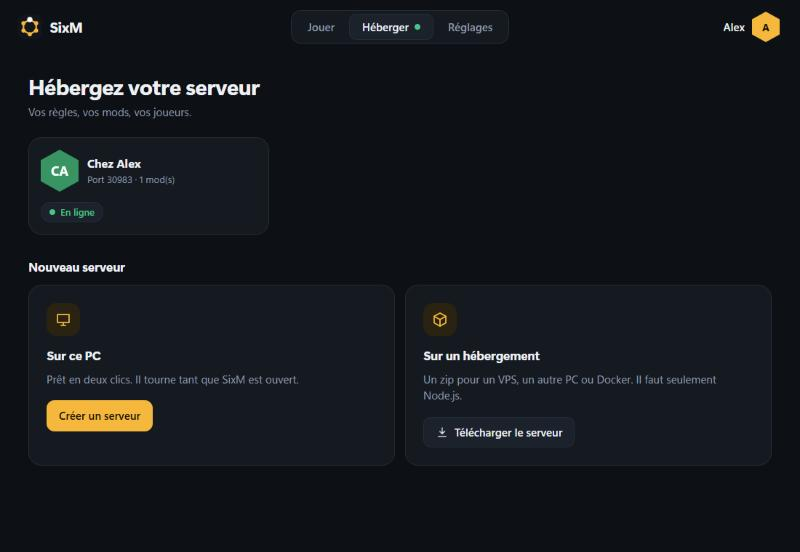

<!-- Généré par scripts/readme.mjs : modifiez ce fichier-là, puis npm run readme -->
<div align="center">


# SixM

**Le multijoueur, les mods et vos serveurs, dans un seul launcher.**

<a href="README.md">English</a> · <b>Français</b> · <a href="README.es.md">Español</a> · <a href="README.de.md">Deutsch</a> · <a href="README.pt-BR.md">Português</a> · <a href="README.zh-CN.md">中文</a> · <a href="README.ja.md">日本語</a> · <a href="README.ru.md">Русский</a>

[](https://github.com/SyanCode/SixM/releases/latest)
[](https://github.com/SyanCode/SixM/actions)

### [Télécharger pour Windows](https://github.com/SyanCode/SixM/releases/latest)

 

</div>

SixM est un framework multijoueur et modding agnostique du jeu, dans l'esprit de FiveM, pensé pour GTA VI sur PC via des projets de portage comme [VIctory](https://github.com/Marvisak/VIctory). Tout le code est original.

## Fonctionnalités

| | |
|---|---|
| **Jouer** | Choisissez un jeu et un serveur, puis Jouer. Favoris, chat, joueurs, radar. Un mode démo marche sans jeu. |
| **VIctory** | Télécharge et compile VIctory sur votre PC, à une version précise, avec journal en direct. Mise à jour toujours manuelle. |
| **Surcouche en jeu** | Chat, joueurs et radar par-dessus la fenêtre du jeu. F8 pour écrire, F9 pour masquer. Windows seulement. |
| **Autres joueurs** | Leurs noms apparaissent dans le monde, à leur place, grâce au module SixM pour VIctory. Demande un profil local. |
| **Héberger** | Votre serveur en deux clics : public ou privé, liste blanche, admins, mot de passe, bannissements, console. |
| **Menus des mods** | Dessinés par SixM d'après ce que décrivent les mods : M pour ouvrir, flèches, cases, listes, curseurs. Un menu d'administration est fourni. |
| **Mods** | Déposez un zip, activez-le. Les joueurs le reçoivent en se connectant. |
| **Sécurité** | Les scripts envoyés par un serveur tournent isolés dans QuickJS/WebAssembly. |

## Télécharger

| Fichier | Pour |
|---|---|
| `SixM-Setup` | Installateur. Node.js inclus, sans droits d'administrateur |
| `SixM-portable` | Sans installation : lancez `SixM.exe` |
| `SixM-Server` | Serveur seul, pour un hébergement. Demande [Node.js](https://nodejs.org) |

Le programme n'est pas signé : Windows SmartScreen peut afficher un avertissement. `SHA256SUMS.txt` donne les empreintes des fichiers.

Depuis le code : `SixM.bat` sous Windows, sinon `npm install` puis `npm run app`. Demande [Node.js](https://nodejs.org) 20.15 ou plus. Interface native : `cargo build --release` dans `desktop/` (sinon l'interface web s'ouvre).

## Démarrage

1. Installez SixM et ouvrez-le.
2. **Réglages** : installez VIctory, puis ajoutez le dossier du jeu extrait de votre propre disque.
3. **Jouer** : choisissez un serveur et cliquez sur Jouer. Pas de jeu ? Gardez le mode démo.

## Héberger un serveur

Dans l'application : **Héberger → Créer un serveur**. Pour qu'il reste en ligne, **Télécharger le serveur** donne un zip pour un VPS, un autre PC ou Docker. En ligne de commande :

```bash
npm install
node bin/sixm.js init ../my-server
node bin/sixm.js start ../my-server
```

## État

| ✅ Fonctionne | ⛔ Pas encore |
|---|---|
| Serveurs, mods, interface et chat | Les noms des autres joueurs dans le jeu demandent un profil de votre version du jeu (aucun n'est fourni) ; leurs personnages restent à faire dans le module |
| Lancement de VIctory et surcouche, testés avec un faux VIctory | VIctory lui-même n'est pas encore jouable, selon ses auteurs |
| VIctory compilé et vérifié, sans jeu | Interface en français seulement ; pas de chiffrement sans proxy TLS |

## Ce que SixM ne fait pas

- Il **ne fournit ni jeu ni code de VIctory** et ne modifie aucun fichier du jeu. Utilisez votre propre copie.
- Ni code ni assets Rockstar, ni fuites, ni builds piratés dans ce dépôt. N'en ajoutez pas.
- Les scripts **serveur** ont accès à la machine qui les héberge : n'installez que des mods de confiance.

## Développement

```bash
npm test
npm run bot
npm run sim-bridge
npm run package
```

Tests, empaquetage et publication sont automatiques : changer la version dans `package.json` publie une version.

## Documentation

- [Hébergement et mods](docs/HOSTING.md)
- [Architecture](docs/ARCHITECTURE.md)
- [Protocole réseau](docs/PROTOCOL.md)
- [Bridge VIctory](integrations/victory/PROTOCOL.md)

---

<div align="center"><sub>Projet indépendant, sans lien avec Rockstar Games, Take-Two ou VIctory.</sub></div>
