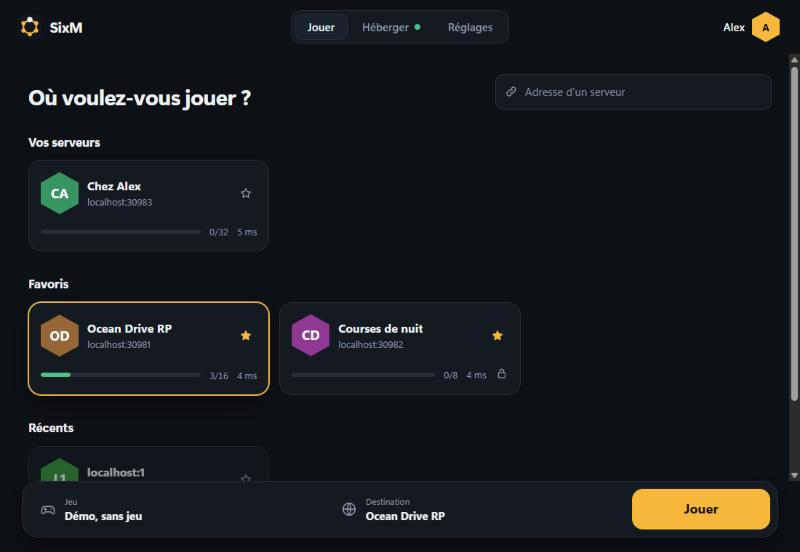

<!-- Généré par scripts/readme.mjs : modifiez ce fichier-là, puis npm run readme -->
<div align="center">


# SixM

**Multiplayer, mods and your own servers, in one launcher.**

<b>English</b> · <a href="README.fr.md">Français</a> · <a href="README.es.md">Español</a> · <a href="README.de.md">Deutsch</a> · <a href="README.pt-BR.md">Português</a> · <a href="README.zh-CN.md">中文</a> · <a href="README.ja.md">日本語</a> · <a href="README.ru.md">Русский</a>

[](https://github.com/SyanCode/SixM/releases/latest)
[](https://github.com/SyanCode/SixM/actions)

### [Download for Windows](https://github.com/SyanCode/SixM/releases/latest)

 

</div>

SixM is a game-agnostic multiplayer and modding framework in the spirit of FiveM, designed for GTA VI on PC through port projects such as [VIctory](https://github.com/Marvisak/VIctory). All code is original.

## Features

| | |
|---|---|
| **Play** | Pick a game and a server, then press Play. Favourites, chat, players, radar. A demo mode needs no game. |
| **VIctory** | Downloads and compiles VIctory, or a fork such as VIctory Belobug AMD, Tequesta or VIctory-NVIDIA, on your PC, at a pinned version, with a live log. Updates are always manual. |
| **In-game overlay** | Chat, players, radar and mod menus on top of the game window. F7 menu, F8 to type, F9 to hide. Windows only. |
| **Other players** | Their names appear in the world, at their position, through SixM's module for VIctory. Needs a local profile. |
| **Host** | Your server in two clicks: public or private, whitelist, admins, password, bans, console. |
| **Mod menus** | Drawn by SixM from what mods describe: M to open, arrows, checkboxes, lists, sliders. An admin menu is included. |
| **Mods** | Drop a zip, switch it on. Players receive it when they connect. |
| **Safety** | Scripts sent by a server run isolated in QuickJS/WebAssembly. |

## Download

| File | For |
|---|---|
| `SixM-Setup` | Installer. Node.js included, no administrator rights |
| `SixM-portable` | No installation: run `SixM.exe` |
| `SixM-Server` | Server only, for hosting. Needs [Node.js](https://nodejs.org) |

The program is not signed, so Windows SmartScreen may show a warning. `SHA256SUMS.txt` lists the file checksums.

From source: `SixM.bat` on Windows, or `npm install` then `npm run app`. Needs [Node.js](https://nodejs.org) 20.15 or later. Native interface: `cargo build --release` in `desktop/` (otherwise the web interface opens).

## Getting started

1. Install SixM and open it.
2. **Réglages** (settings): install VIctory, then add the game folder extracted from your own disc.
3. **Jouer** (play): choose a server and press Jouer. No game? Keep the demo mode.

## Host a server

In the app: **Héberger → Créer un serveur**. To keep it online, **Télécharger le serveur** gives a zip for a VPS, another PC or Docker. From a terminal:

```bash
npm install
node bin/sixm.js init ../my-server
node bin/sixm.js start ../my-server
```

## Status

| ✅ Works | ⛔ Not yet |
|---|---|
| Servers, mods, interface and chat | Other players' names in the game need a profile for your game version (none is provided); their characters need more work in the module |
| Launching VIctory and the overlay, tested with a fake VIctory | VIctory itself is not playable yet, according to its authors |
| VIctory compiled and checked, without a game | Interface in French only; no encryption without a TLS proxy |

## What SixM does not do

- It **ships no game and no VIctory code**, and modifies no game file. Use your own copy.
- No Rockstar code or assets, no leaks, no pirated builds in this repository. Do not add any.
- **Server** scripts have access to the machine that hosts them: install only mods you trust.

## Development

```bash
npm test
npm run bot
npm run sim-bridge
npm run package
```

Tests, packaging and releases are automatic: changing the version in `package.json` publishes a release.

## Documentation

- [Hosting and mods](docs/HOSTING.md)
- [Architecture](docs/ARCHITECTURE.md)
- [Network protocol](docs/PROTOCOL.md)
- [VIctory bridge](integrations/victory/PROTOCOL.md)

In French.

---

<div align="center"><sub>Independent project, not affiliated with Rockstar Games, Take-Two or VIctory.</sub></div>
